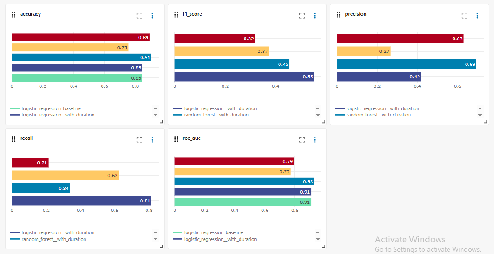
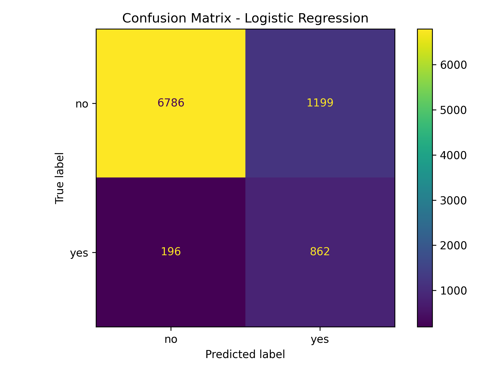
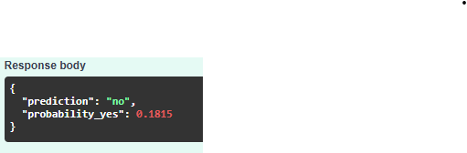
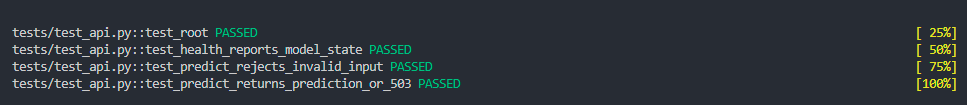

# Bank Marketing MLOps Pipeline

End-to-end machine learning pipeline that predicts whether a bank customer will subscribe to a term deposit, built with a reproducible DVC pipeline, MLflow experiment tracking, a FastAPI prediction service, automated tests and CI.

The dataset is the UCI Bank Marketing dataset, which records the outcome of direct marketing phone calls made by a Portuguese bank.

---

## The problem, and why accuracy is the wrong measure

Only a small fraction of contacted customers actually subscribe. In the held-out test set, 1,058 of 9,043 customers did, about 11.7 percent. That imbalance makes accuracy misleading. A model that predicts "no" for every single customer would still score 88.3 percent accuracy while being completely useless, because it would never identify anyone worth calling.

What matters commercially is **recall on the positive class**. A customer who would have subscribed but is never contacted is lost revenue. A customer who is contacted and declines costs a few minutes of an agent's time. The two errors are not equally expensive, so the model is selected on F1 over the positive class rather than on accuracy.

---

## Measuring a leaking feature

The dataset includes a `duration` column recording how long the marketing call lasted. The value only exists **after** the call has finished, so a model using it cannot decide who to call. It is the best-known trap in this dataset, and models trained with it report scores that cannot be reproduced in production.

Rather than note the problem and move on, this project measures it. Both candidate models are trained twice, with and without the feature, and all four runs are logged to MLflow.

### With `duration` (not deployable)

| Model | Accuracy | Precision | Recall | F1 | ROC-AUC |
|---|---|---|---|---|---|
| Logistic Regression | 0.8457 | 0.4182 | 0.8147 | **0.5527** | 0.9079 |
| Random Forest | 0.9051 | 0.6938 | 0.3384 | 0.4549 | 0.9286 |

### Without `duration` (deployable)

| Model | Accuracy | Precision | Recall | F1 | ROC-AUC |
|---|---|---|---|---|---|
| **Logistic Regression** | 0.7548 | 0.2662 | 0.6238 | **0.3732** | 0.7722 |
| Random Forest | 0.8933 | 0.6303 | 0.2127 | 0.3180 | 0.7929 |

### The cost of removing it

| Model | Accuracy | Precision | Recall | F1 | ROC-AUC |
|---|---|---|---|---|---|
| Logistic Regression | -0.0909 | -0.1520 | -0.1909 | **-0.1795** | -0.1357 |
| Random Forest | -0.0118 | -0.0635 | -0.1257 | **-0.1369** | -0.1357 |

Logistic Regression loses a third of its F1, falling from 0.5527 to 0.3732. Recall drops from catching 81 percent of subscribers to 62 percent.

The ROC-AUC column is the clearest evidence. Both models lose **exactly 0.1357**, despite being entirely different algorithms. ROC-AUC does not depend on where the decision threshold sits, so that identical fall measures pure information loss rather than a shift in calibration. Roughly 0.14 of apparent performance was coming from a feature unavailable at decision time.



**0.3732 is the honest number for this project.** The 0.5527 version is reported here for comparison only.

---

## Why Logistic Regression was selected

Selection is made on the realistic scenario, so the chosen model is the better of the two **without** `duration`.

Logistic Regression wins on F1, 0.3732 against 0.3180. The gap comes almost entirely from recall: 0.6238 against 0.2127. Random Forest misses close to four out of five subscribers, which defeats the purpose of the model however good its accuracy looks.

Random Forest does hold a higher accuracy, 0.8933 against 0.7548, and a marginally higher ROC-AUC. Its accuracy advantage is largely an artefact of the imbalance, since predicting "no" is right 88.3 percent of the time by default. Its ROC-AUC edge suggests it ranks customers slightly better, so if the business wanted a ranked call list rather than a yes-or-no decision, it would be worth revisiting with a tuned threshold.

Two further points favour Logistic Regression. Coefficients are directly interpretable, which matters in a regulated setting where a bank may need to explain why a customer was targeted. And inference is cheap, which keeps the serving path simple.

### What the errors look like



The matrix above is from the model trained **with** `duration`, across 9,043 held-out customers of whom 1,058 subscribed.

| | Predicted no | Predicted yes |
|---|---|---|
| **Actually no** | 6,786 | 1,199 |
| **Actually yes** | 196 | 862 |

It catches 862 of the 1,058 real subscribers and misses 196, at the price of 1,199 customers flagged who would not have subscribed. Those 1,199 false positives are wasted calls and the 196 misses are lost sales. Favouring recall means accepting more of the cheaper mistake to avoid the expensive one.

---

## Pipeline

Defined in `dvc.yaml` as four stages. DVC tracks the dependencies between them, so changing one file re-runs only the stages affected by it.

```
data/raw/bank-full.csv
        │
        ▼
   [inspect]  src/data/inspect_data.py
        │     cleaning and initial checks
        ▼
   data/processed/bank_stage1.csv
        │
        ▼
   [split]    src/data/split_data.py
        │     stratified train/test split
        ▼
   train.csv  +  test.csv
        │
        ▼
   [train]    src/pipelines/train_final_model.py
        │     fits the selected model, logs to MLflow
        ▼
   models/final_model.joblib  +  metrics
        │
        ▼
   [evaluate] src/models/evaluate_model.py
              confusion matrix, classification report, metrics.json
```

```bash
dvc repro
```

The leakage experiment runs separately, since it is an analysis rather than a pipeline stage:

```bash
python src/models/compare_models.py
```

That writes `reports/metrics/model_comparison.json`, `model_comparison_no_duration.json` and `duration_leakage_report.json`, and logs four runs to MLflow.

## Serving

`src/api/main.py` loads the trained model and exposes three endpoints.

| Endpoint | Method | Purpose |
|---|---|---|
| `/` | GET | Service running check |
| `/health` | GET | Reports whether the model file loaded |
| `/predict` | POST | Returns the predicted class and the probability of "yes" |

The service starts even when the model file is absent. `/health` then reports `model_loaded: false` and `/predict` returns a 503 with a clear message, rather than the process crashing on startup. A service that fails to boot tells an operator nothing, while one that starts and reports its own state can be diagnosed.

---

## Setup

### 1. Clone and install

```bash
git clone https://github.com/kenil0savani/bank-marketing-mlops.git
cd bank-marketing-mlops

python -m venv .venv
source .venv/bin/activate        # Windows: .venv\Scripts\activate
pip install -r requirements.txt
```

### 2. Get the data

The DVC remote for this project is a local folder on the author's machine, so `dvc pull` will not work from a fresh clone. Download the dataset directly instead.

Get `bank-full.csv` from the [UCI Bank Marketing dataset](https://archive.ics.uci.edu/dataset/222/bank+marketing) and place it at `data/raw/bank-full.csv`.

### 3. Run the pipeline

```bash
dvc repro
```

This produces `models/final_model.joblib` along with the metrics and figures under `reports/`.

### 4. Start the API

```bash
uvicorn src.api.main:app --reload
```

Interactive documentation is then available at `http://localhost:8000/docs`.

### Example request

```bash
curl -X POST http://localhost:8000/predict \
  -H "Content-Type: application/json" \
  -d '{
    "age": 35, "job": "management", "marital": "married",
    "education": "tertiary", "default": "no", "balance": 1200.5,
    "housing": "yes", "loan": "no", "contact": "cellular",
    "day": 15, "month": "may", "duration": 180, "campaign": 2,
    "pdays": -1, "previous": 0, "poutcome": "unknown"
  }'
```

```json
{"prediction": "no", "probability_yes": 0.1815}
```



### Run with Docker

```bash
docker build -t bank-marketing-mlops .
docker run -p 8000:8000 bank-marketing-mlops
```

---

## Experiment tracking

Runs are logged to MLflow under the experiment `bank-marketing-model-comparison`, with the model name, scenario, feature count and row counts as parameters.

```bash
mlflow ui
```

The tracking store is generated locally and is not committed to this repository.

## Testing and CI

```bash
python -m pytest -v
```

Four tests cover the root and health endpoints, request schema validation, and the prediction path. The prediction test adapts to whether a model file is present, so the same suite passes locally with a trained model and on CI without one.



GitHub Actions runs the suite on every push and pull request to `main`.

---

## Project structure

```
configs/              model configuration
data/raw/             source dataset (DVC tracked)
data/processed/       pipeline outputs (DVC tracked)
src/data/             inspection and splitting
src/models/           model comparison, leakage experiment, evaluation
src/pipelines/        final training, MLflow logging
src/api/              FastAPI prediction service
models/               trained model artefacts (DVC tracked)
reports/metrics/      metrics, comparisons and the leakage report
reports/figures/      confusion matrix
tests/                pytest suite
dvc.yaml              pipeline definition
Dockerfile            container image for the API
.github/workflows/    CI
```

---

## Known limitations

**The DVC training stage still includes `duration`.** The leakage experiment in `src/models/compare_models.py` selects and saves a model trained without it, but `src/pipelines/train_final_model.py`, which produces the artefact the API serves, has not yet been aligned. Bringing the serving path onto the deployable model is the next change.

**Precision is low on the deployable model.** At 0.2662, roughly one in four flagged customers actually subscribes. That is the deliberate cost of favouring recall, but a campaign built on these predictions would involve a large number of unproductive calls. Whether that trade is worth making depends on the real cost of a call against the value of a subscription.

**The decision threshold is untuned.** Predictions use the default 0.5 cut-off. Since probabilities are already produced, sweeping the threshold against the test set would allow the precision and recall balance to be chosen deliberately rather than inherited.

**The DVC remote is local.** Data and model artefacts cannot be pulled from a fresh clone. A shared remote such as S3 or Azure Blob Storage would make the pipeline fully reproducible for anyone.

**Single train/test split.** Results come from one hold-out split of 9,043 records rather than cross-validation, so the figures carry more variance than they appear to.

## Licence

MIT
